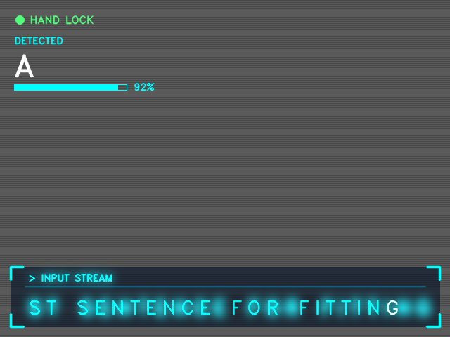

# Sign Language Writer

Real-time fingerspelling recognition from a webcam. Sign letters with your hand and watch the sentence build on screen in a sci-fi style HUD.

Built with [MediaPipe Hands](https://developers.google.com/mediapipe) for landmark extraction and a scikit-learn random forest for classification. Because you record your own samples, it works with any sign language whose alphabet uses static handshapes (ASL, Turkish Sign Language, and others).



*Rendered test frame of the on-screen HUD (no live hand in this image).*

## Features

- Train on **your own** hand data in a few minutes
- Landmark-based features (wrist-relative, scale-normalized), so it is robust to distance, lighting and background
- Stability filter: a letter is accepted only after being predicted consistently over several frames
- Gestures for **space** and **delete**
- Neon HUD with glow, blinking cursor, confidence bar and hand-lock indicator

## Requirements

- Python **3.10 - 3.12** (MediaPipe does not yet support newer versions such as 3.14)
- A webcam
- Windows, macOS or Linux

## Installation

```bash
git clone https://github.com/<Yaseen_Botchway>/sign-language-writer.git
cd sign-language-writer

python -m venv venv
# Windows (PowerShell):  .\venv\Scripts\Activate.ps1
# macOS / Linux:         source venv/bin/activate

python -m pip install --upgrade pip
python -m pip install -r requirements.txt
```

> `mediapipe` is pinned to 0.10.21 because newer releases removed the `mp.solutions` API this project uses.

## Usage

Run the three steps in order, one at a time.

### 1. Collect samples

```bash
python sign_writer.py collect
```

| Key | Action |
|-----|--------|
| `a`-`z` | Record a burst of 40 samples for that letter |
| `1` | Record the **space** gesture (e.g. flat open palm) |
| `2` | Record the **delete** gesture (e.g. closed fist) |
| `q` | Quit |

Tips: record 2-3 bursts per sign, varying distance, angle and position. Use the same hand and camera setup you will use live. Only record letters you actually need.

### 2. Train

```bash
python sign_writer.py train
```

Prints a per-class report and saves `sign_model.joblib`. The score is optimistic because neighbouring frames in a burst are nearly identical, so judge the model by live performance.

### 3. Run

```bash
python sign_writer.py run
```

| Key | Action |
|-----|--------|
| `c` | Clear the sentence |
| `b` | Backspace |
| `s` | Save the sentence to `sentences.txt` |
| `q` | Quit |

To type a double letter (e.g. "LL"), briefly drop your hand out of frame between the two.

## Configuration

Constants at the top of `sign_writer.py`:

| Name | Default | Effect |
|------|---------|--------|
| `BURST` | 40 | Samples recorded per key press |
| `STABLE_FRAMES` | 12 | Frames a prediction must persist before it is accepted |
| `MIN_CONF` | 0.75 | Minimum classifier probability |

Raise `MIN_CONF` / `STABLE_FRAMES` if wrong letters fire; lower them if letters are slow or never appear. HUD colors are the `CYAN`, `GREEN` and `RED` constants (BGR order).

## How it works

1. OpenCV captures webcam frames (mirrored for natural interaction).
2. MediaPipe Hands returns 21 3D landmarks for one hand.
3. Landmarks are translated so the wrist is the origin and scaled by hand size, giving a 63-dimensional feature vector.
4. A random forest predicts the sign and its probability.
5. A stability buffer accepts a sign only after it is consistent over `STABLE_FRAMES` frames, then appends it to the sentence.

## Limitations

- Static handshapes only. Letters involving motion (e.g. ASL J and Z) are not supported.
- Similar shapes (e.g. M/N/S) are the hardest to separate and need more varied data.
- A model trained on one person generalizes poorly to others; record from several people for better results.
- One hand, letter by letter. This is not continuous sentence-level sign recognition.

## Troubleshooting

| Problem | Fix |
|---------|-----|
| `No module named 'cv2'` | Install into the active environment: `python -m pip install -r requirements.txt` |
| `module 'mediapipe' has no attribute 'solutions'` | `pip install mediapipe==0.10.21` |
| `mediapipe` fails to install | Use Python 3.10-3.12 |
| Webcam does not open | Close other apps using the camera, or change the index in `cv2.VideoCapture(0)` |

## Roadmap

- [ ] Confusion matrix and burst-based validation
- [ ] Engineered features (fingertip distances, finger angles) and data augmentation
- [ ] Word-level signs with landmark sequences (LSTM / Transformer)
- [ ] Word autocomplete / language-model error correction
- [ ] Custom font rendering for the HUD

## License

MIT. See [LICENSE](LICENSE).
